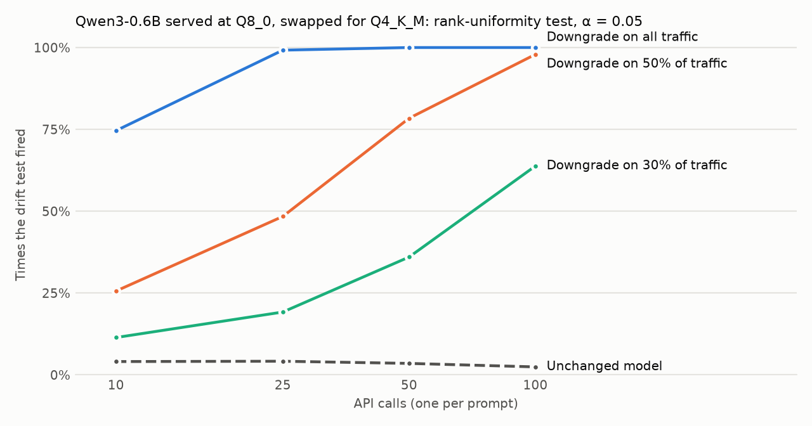

<h1 align="center">tracta</h1>

<p align="center"><b>Checks you run yourself to see whether a model provider still serves the model it promised, and research on reading which parts of a model carry a behaviour.</b></p>

<p align="center">Runs on your own machine, on CPU. No account, no server, no telemetry.</p>

<p align="center">
  
  
  
</p>

## Install

| Need | Command |
|---|---|
| llama.cpp (macOS, Linux) | `brew install llama.cpp` |
| Python 3.12 packages | `pip install numpy scipy torch transformers matplotlib` |
| Qwen3-0.6B weights | GGUF files at Q8_0, Q4_K_M and bf16, plus the Hugging Face `Qwen/Qwen3-0.6B` folder, in one directory |

Run one calibration campaign. It starts `llama-server` on CPU for each arm, sends about 9,400 requests, and writes `runs.jsonl` and `results.json` to the folder you name:

```bash
sh experiments/drift-calibration/campaign.sh /path/to/model-dir /path/to/work-dir
```

On an M4 Pro, collection takes about 45 minutes and scoring about 6 minutes. The campaign uses no GPU and needs no API key, because the "provider" is a local server.

## Why

You pay a provider for model X and see only its answers. On a busy day it can serve a quantised copy, a smaller sibling, or a mix, and the bill stays the same. A weight hash cannot help, because you never see the weights.

tracta samples the provider on normal days to build a baseline, then flags a later sample that moves further than the baseline moves against itself. It reports a detection rate and a false-alarm rate, never a guarantee. A provider that recognises probe traffic can serve the real model to the probes, so the probes have to look like ordinary use.

## Results



On Qwen3-0.6B, a full swap from Q8_0 to Q4_K_M sets the test off in 99% of 25-call checks. Unchanged days set it off in 4%, close to the 5% the test allows. A swap on 30% of traffic needs about 200 calls; on 10% it does not show within 200. Reproduce with `python experiments/drift-calibration/plot.py experiments/drift-calibration/results/2026-10-29/results.json out.png`. Raw answers: [`runs.jsonl.gz`](experiments/drift-calibration/results/2026-10-29/runs.jsonl.gz).

## The three drift checks

- **Rank uniformity (B1).** For each prompt, the served answer's likelihood is ranked among 20 answers from your own copy of the published weights. Ranks are uniform when the model is unchanged and skew low after a downgrade. This check needs the weights to be open, and its false-alarm rate was measured with real sampling noise.
- **Knowledge-boundary answers (B2).** Greedy answers to 436 short facts and sums. The swap changed 41% of answers; unchanged days changed none.
- **Single-token fingerprint (F1).** First-token distributions on 40 one-word prompts, compared by Jensen-Shannon divergence. One prompt separated every pair of precisions, Q8_0 against bf16 included.

B2 and F1 ran against a local server that gave bit-identical outputs across seeds, thread counts and batching. Their false-alarm floor was therefore zero, and a hosted API will have one above zero. The next run serves the same file through a second engine to measure that floor.

## Also in this repo

The project's wider question is which component of a model (a neuron, a direction, an expert) carries a behaviour. Two tracks are on paper and not yet run:
- tamper checks for runtime steering and abliteration;
- expert-path attribution on existing open mixture-of-experts models, labelled by topic.

## Commands

```bash
sh experiments/drift-calibration/campaign.sh MODEL_DIR WORK_DIR    # full campaign: collect, then analyse
python experiments/drift-calibration/collect.py --model M --tag T --out R --log L   # one arm only
python experiments/drift-calibration/analyse.py --runs R --scorer HF_DIR --out J    # B1, B2, F1 from a runs file
python experiments/drift-calibration/plot.py J PNG                                  # the Results chart
```

## Verify it yourself

```bash
sh experiments/drift-calibration/campaign.sh MODEL_DIR WORK_DIR
python -c "import json; r=json.load(open('WORK_DIR/results.json'))['b1']['arms']; print({t: v['reject_rate_by_n']['25'] for t, v in r.items()})"
```

The unchanged arms (`q8-day1` to `q8-day3`) must fire in about 5% of 25-call checks, and the `q4-day` arms in nearly all of them. The 2026-10-29 campaign gave 3.6–4.9% and 98.1–99.7%. That campaign is one run of one model and one downgrade, with no repeat.

## License

No license file yet. Code under `experiments/`, data under `experiments/*/results/`. Plans and the research charter live in a private plans store, not in this repo.
