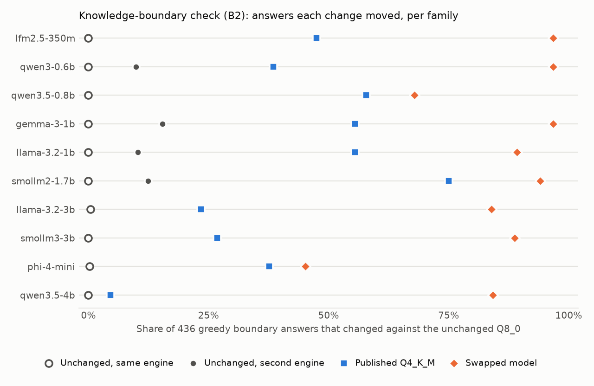

<h1 align="center">tracta</h1>

<p align="center"><b>Check whether your model provider still serves the model it promised, from its answers alone.</b></p>

<p align="center">One static binary for macOS, Linux and Windows. No account, no server, no telemetry.</p>

<p align="center">
  
  
  
</p>

## Install

| Way | Command |
|---|---|
| Go | `go install github.com/NakliTechie/tracta/cmd/tracta@latest` |
| Build all platforms | `sh scripts/build-binaries.sh` writes `dist/tracta-<os>-<arch>` and `SHA256SUMS` |
| Python reference version | `python3 -m tracta` from a clone (no dependencies) |

Watch a provider. Record a baseline on two days you trust, then check on any later day. Each check writes a Markdown and a JSON report to `~/.tracta/<name>/reports/`:

```bash
tracta baseline --name myprovider --endpoint https://api.example.com/v1 --model some-model --key-env EXAMPLE_API_KEY
tracta baseline --name myprovider          # a second baseline, ideally on another day
tracta check --name myprovider             # exit 0 no change, 2 changed, 3 no verdict
```

tracta talks to any OpenAI-compatible chat endpoint, and to the Claude API through Anthropic's Go SDK (`--endpoint https://api.anthropic.com`). A run is 436 short questions of up to 16 tokens each. The API key stays in your environment, and only the questions go to the endpoint you name. Example report: [`docs/example-report.md`](docs/example-report.md).

## Why

You pay a provider for model X and see only its answers. On a busy day it can serve a 4-bit copy, a smaller sibling or another model, and the bill stays the same. A weight hash cannot help, because you never see the weights.

tracta asks short factual questions near the edge of what a model knows. A swapped or quantised model answers many of them differently. tracta compares today's answers with your baselines, and reports a change only when it exceeds the provider's own day-to-day noise, at a stated false-alarm rate.

## Results



Across ten published models from 0.35B to 4B on local servers, serving the family's published Q4_K_M changed 4.6–75% of these answers, and serving another model changed 45–97%. Serving the same file again changed 0–0.5%. Serving it through a second inference engine changed 10–15%, measured for four of the ten families. Qwen3.5-4B's Q4_K_M moved only 4.6%, and its second-engine noise was not measured, so that case is unresolved. Reproduce with `python experiments/drift-calibration/plot_families.py experiments/drift-calibration/results/2026-10-30 out.png`.

**Hosted test (Claude API).** Two Claude Haiku 5.5 baselines agreed on all 436 answers, and a third Haiku run gave no change (p = 1). Calling Claude Sonnet 5.5 instead was detected (p = 0.00098), but only through 10 answers: Sonnet started showing its working, and one product differed. Strong models answer nearly all of these questions correctly, so against frontier-class models the check has little margin. Runs and reports: [`results/2026-10-30-hosted-claude/`](experiments/drift-calibration/results/2026-10-30-hosted-claude/).

## How a check decides

tracta anchors on your first baseline and compares two runs with it, question by question: today's run and your latest other baseline. If the provider has not changed, those two runs are interchangeable. So on questions where exactly one of them moved, each is equally likely to be the one. An exact sign test on those questions gives the p-value, with no assumption that all questions are equally noisy.

Check number k may spend α·6/(π²k²) of a total false-alarm budget α, 0.05 by default. Those shares add up to α over any number of checks, so checking daily does not raise the chance of a false alarm above α. A check without a verdict spends nothing, and the report shows the budget spent.

## What it cannot tell you

- **Why the answers changed.** An announced model update, a new default system prompt or new sampling settings also count as a change.
- **What a probe-aware provider serves.** A provider that recognises tracta's requests can serve the real model to them. Each user's questions come from a private seed, which makes that harder, not impossible.
- **Changes that spare short factual answers.** These are invisible, including a swap between two strong models that both know the answers.
- **Changes before your first baseline.** tracta compares only with your own baselines.

## Your own questions

The built-in set is 436 questions: atomic numbers both ways, and 200 multiplications drawn from a private seed. To ask your own instead, give a JSON Lines file when you create the watch, one question per line ([example](docs/questions-example.jsonl)). This option is newer than v0.2.0: until the next release, build from main with `go install github.com/NakliTechie/tracta/cmd/tracta@main`.

```bash
tracta baseline --name myprovider --endpoint URL --model M --questions my-questions.jsonl
```

Each line needs an `id` and a `prompt`; an `answer` is allowed and ignored, because a check compares runs with each other, never with a correct answer. The watch keeps its own copy, so later baselines and checks ask the same list. Ask for short answers: tracta reads at most 16 tokens and compares the first number, else the first word. Harder questions near the edge of what your model knows give more power against strong models, where the built-in set has little margin. The results above were measured on the built-in set only. The Python reference version has only the built-in set.

## Commands

```bash
tracta baseline --name N --endpoint URL --model M [--api openai|anthropic] [--key-env VAR] [--extra-body JSON] [--questions FILE] [--logprobs]
tracta check --name N [--alpha 0.05] [--model M]   # --model calls another model, to test the check with a swap
tracta status --name N
tracta version
```

`--extra-body` merges provider-specific fields into every request, for example `{"thinking":{"type":"disabled"}}` for Claude Haiku 5.5. `--logprobs` records a token fingerprint as supporting evidence where the endpoint returns log-probabilities; only the sign test decides.

## Verify it yourself

```bash
go test ./...
python3 -m unittest discover -s tests
TRACTA_BIN=dist/tracta sh tests/e2e_local.sh /path/to/models /tmp/tracta-e2e
```

The Go tests replay stored runs and require the same verdicts, counts and p-values as the Python reference version. The Python tests check the statistics against SciPy. The end-to-end script drives the real binary against local llama-server providers built from the pinned files in `experiments/drift-calibration/models.json`. It expects no verdict from one baseline, no change on the unchanged Q8_0, and "changed" for the published Q4_K_M and for a swap. The macOS arm64 binary passed it, and the Windows amd64 binary passed the same four cases against a server on another machine. The Linux and Intel macOS builds have not been run.

## Research behind it

`experiments/drift-calibration/` holds the experiments: three statistics (B2, used here; a rank test, B1; a token fingerprint, F1), ten model families, a second inference engine, and every model file pinned by hash. Two further tracks are on paper: tamper checks for runtime steering and abliteration, and expert-path attribution in mixture-of-experts models.

## License

MIT. See [LICENSE](LICENSE).
